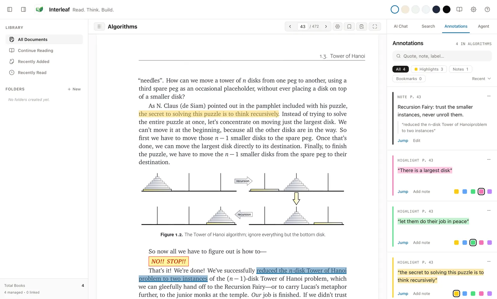
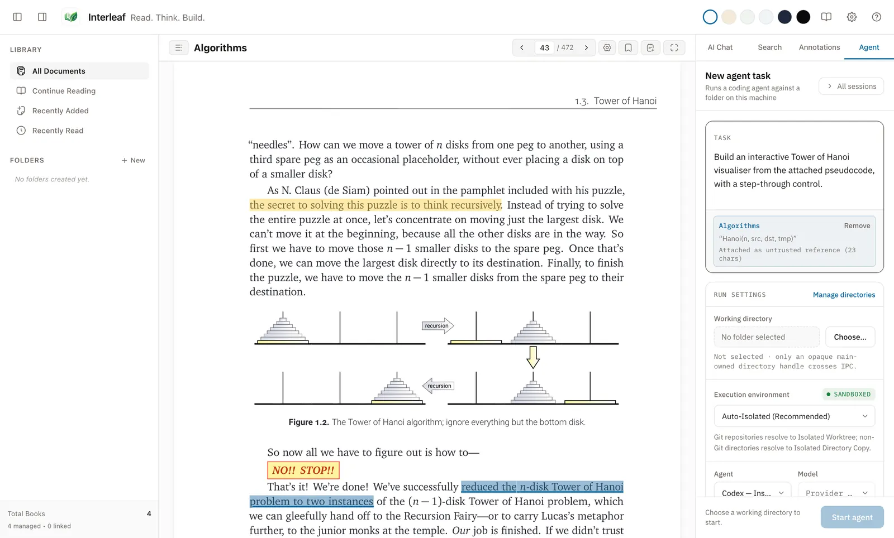
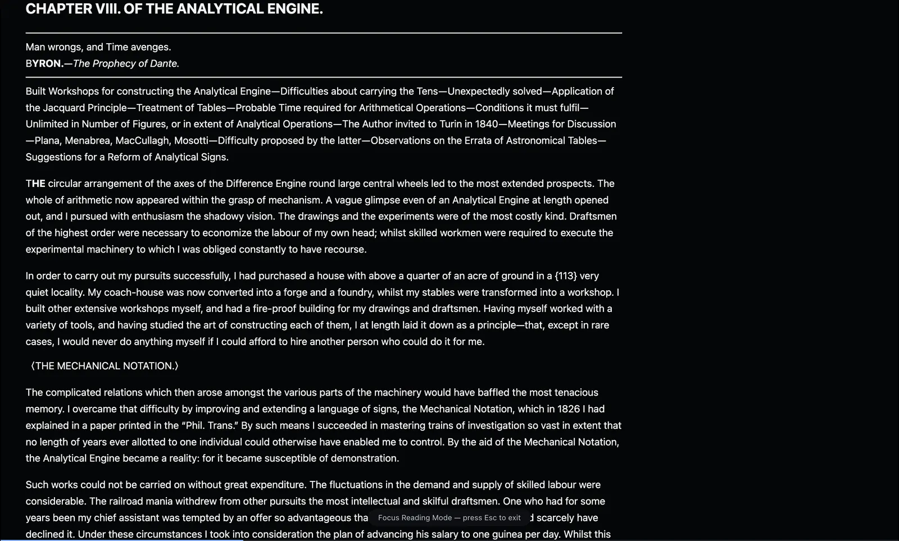
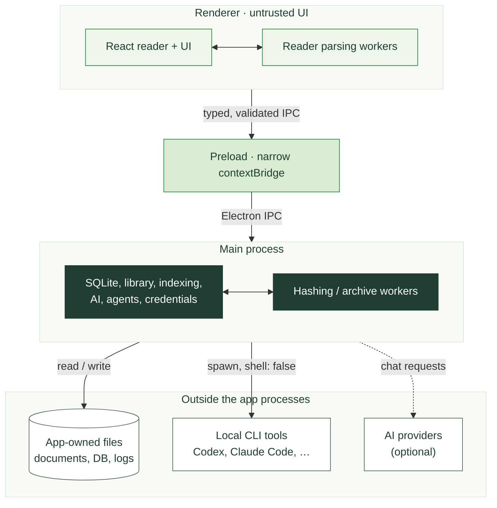

<p align="center">
  
</p>

<p align="center">
  <a href="LICENSE"></a>
  <a href="package.json"></a>
  
  <a href="https://github.com/electron/electron"></a>
</p>

Interleaf is a local-first Electron desktop reader for PDF, EPUB, MOBI/KF8,
DOCX, PPTX and Markdown documents, including saved web articles. It combines persistent annotations and lexical search with
an optional document chat panel and a controlled handoff to local coding-agent
CLIs. Reading and annotation do not require an online account.

## 📖 User wiki

**New here?** Build the wiki and open it in a browser — you get a searchable,
categorized site with all 28 wiki pages:

```bash
node --disable-warning=MODULE_TYPELESS_PACKAGE_JSON wiki.build.ts
python3 -m http.server --directory out/wiki 4173
# then open http://127.0.0.1:4173/
```

The site is plain static files, so it also works from any static web host or a
subdirectory of one. See [Wiki website](docs/WIKI_WEBSITE.md) for editing,
rebuilding and hosting details.

The pages come from `docs/wiki/`, which stays readable on its own — start at
[Interleaf Wiki](docs/wiki/README.md). It is the task-oriented guide for people
*using* Interleaf, with step-by-step pages and exact on-screen labels:

| | |
| --- | --- |
| [Quick start](docs/wiki/quick-start.md) | First launch to first AI question |
| [Installation](docs/wiki/installation.md) | Where downloads will come from, installing a trusted build, running from source, or building a package yourself |
| [App navigation](docs/wiki/navigation.md) · [Keyboard shortcuts](docs/wiki/keyboard-shortcuts.md) | Every panel, button and binding |
| [Adding documents](docs/wiki/adding-documents.md) · [Document formats](docs/wiki/formats/README.md) | Open a file or import it to the library, and what each format supports |
| [Reading](docs/wiki/reading.md) · [Highlights and notes](docs/wiki/highlights-and-notes.md) | Navigating, annotating, finding things again |
| [AI providers](docs/wiki/ai-providers.md) | Which provider does Chat, Agent, or both |
| [AI Chat](docs/wiki/ai-chat.md) · [AI Agent](docs/wiki/ai-agent.md) | Context and citations; runs, diffs and applying changes |
| [Help and troubleshooting](docs/wiki/help-and-troubleshooting.md) · [FAQ](docs/wiki/faq.md) | When something goes wrong |

The rest of this README is developer-facing.

This repository contains an actively developed implementation. Provider
availability and platform packaging remain environment-dependent; this
documentation does not make a release-readiness claim. Nothing is published for
download yet: installers will be releases of the public
[`FrescoFlacko/interleaf-releases`](https://github.com/FrescoFlacko/interleaf-releases)
repository, which has no release yet. The update signing key is bootstrapped
and pinned from 0.5.0 (see [Stable updates](docs/PACKAGING.md#stable-updates)).
ChatGPT Reader Chat runs through an explicitly user-authorized constrained Codex
path, but it is **not genuinely tool-free**. Run the commands below after any
change.

- **Open** (`⌘/Ctrl + O`) reads a file in place without adding it to the
  library, in a temporary store discarded on close; **Import to Library**
  (`⌘/Ctrl + Shift + O`) keeps it.
- Guided first-run setup that detects installed AI tools and offers chat and
  agent defaults; reading needs no account or AI.
- Library import with managed-copy (default) and link-in-place storage,
  SHA-256 deduplication, virtual folders, drift detection, and reading
  positions.
- PDF, EPUB, MOBI/KF8/AZW3, hardened direct-OOXML DOCX and PPTX, and Markdown
  readers, plus public web articles saved as offline Markdown snapshots.
  EPUB/MOBI/Markdown are reflowable; PDF remains fixed-layout; DOCX uses
  responsive derived pages; PPTX decks are read as inert slide text and still
  images.
- Highlights, highlight notes, location notes, bookmarks, five highlight
  colors, annotation filtering/search, and format-specific anchor recovery.
- Current-document search and SQLite FTS5-backed indexing with source locations.
- Persistent one-document chat sessions, explicit selection/location/page-range
  context, bounded retrieval, streamed responses, and validated citation jumps.
  The chat panel offers starter prompts, suggested follow-ups that only fill the
  composer, and a Prompt details view of what was sent.
- Detected built-in agent profiles for Codex, Claude Code, Antigravity,
  OpenCode, Pi, and Cursor. Missing CLIs are shown as unavailable rather than
  crashing the app. GitHub Copilot is not offered: it cannot run unattended
  Agent Mode in this integration.
- Six semantic reading palettes (Paper, Sepia, Moss, Ocean, Graphite,
  Midnight), resizable panels, keyboard shortcuts, and Focus Reading Mode.

Known limitations are deliberate: DRM circumvention and full Word/PDF editing
are out of scope; scanned image-only PDFs have no text search without OCR; chat
and agent tasks use one active source document; and Container Sandbox is
currently unavailable and fails closed. Interactive document media is
permanently unsupported: Interleaf retains inert text/captions and ordinary
images under each reader's format policy, but never exposes or plays audio,
video, executable embeds, frames, forms, or document-supplied canvas programs.
Original imported files may remain intact as opaque source data.

## Screenshots

Captured from a production build of Interleaf 0.3.2 with a demo library of four
openly licensed books; see [website/PROVENANCE.md](website/PROVENANCE.md).


*Library: four openly licensed books in the grid view.*


*Reader and annotations. The highlights and the note are demo annotations.*


*AI Chat with a selected passage attached as context. The answer is a fixed sample
from a test fixture; no model was called.*


*A drafted agent task. The agent CLI is an inert test fixture and nothing was
run.*


*Focus Reading Mode in the dark Midnight palette.*

## Architecture



SQLite is main-process-only. The preload exposes named domain operations, not
raw `ipcRenderer`, filesystem methods, SQL, or shell execution. Reader parsing
workers run beside renderer adapters; main-owned hashing/archive workers return
bounded results. See [docs/ARCHITECTURE.md](docs/ARCHITECTURE.md) and
[docs/SECURITY.md](docs/SECURITY.md).

## Supported formats

| Format | Current reader | Anchor basis | Limitations |
| --- | --- | --- | --- |
| PDF | `pdfjs-dist` | Page, normalized rectangles, text quote/context | Fixed layout; image-only text search unavailable |
| EPUB | Pinned Foliate-derived adapter | CFI/spine plus text quote/context | DRM content rejected |
| MOBI/KF8/AZW3 | Pinned Foliate-derived parser/adapter | Section/progression plus text quote/context | DRM content rejected |
| DOCX | Bounded direct OOXML parser | Paragraph/range plus text quote/context | Page numbers are derived hints |
| PPTX | Bounded direct OOXML slide reader sharing the DOCX view | Slide paragraph/range plus text quote/context | Reading text only; no layout, notes, or active content |
| Markdown | Sanitized Markdown renderer | Chunk/range plus text quote/context | Remote content never loaded; web articles are offline snapshots |

Binary documents stay on disk; metadata, chunks, annotations, chat, and agent
session records are stored in SQLite. Ordinary reading is offline-first.

## AI providers and authentication

Interleaf distinguishes subscription-backed local CLIs from API-key providers:

- **Claude Code** can provide Reader Chat when the local CLI is installed and
  authenticated. Chat uses the configured tool-free invocation.
- **Codex** Reader Chat uses the explicitly user-authorized constrained,
  read-only `codex exec` path: main resolves the canonical binary, uses a
  private empty cwd, approval-never, ignored user config/rules, minimal env,
  bounded I/O/time, cancellation, and fail-closed tool-event aborts. This is
  residual-risk containment, **not genuinely tool-free execution**.
- **OpenRouter** provides streamed Reader Chat after an API key is configured
  in Settings. The key is encrypted with Electron `safeStorage` in main and is
  never returned to the renderer or written to plaintext settings/SQLite/logs.
- **FakeAIProvider** is available only in test/development builds for
  deterministic tests; it consumes no paid tokens.

A ChatGPT/Claude subscription is not an OpenAI/Anthropic API key. Interleaf
uses each provider's supported local authentication flow and never asks for
passwords or extracts browser cookies. Provider status is runtime-detected;
installed does not necessarily mean authenticated or chat-capable.

## Agent execution and sandbox modes

The renderer constructs a typed context packet from the selected reader passage.
Main validates it, stores a bounded owner-only packet under app storage, escapes
it into the agent prompt, and never writes it into the target repository.

| Mode | Resolution and current behavior | Important boundary |
| --- | --- | --- |
| **Auto-Isolated** (default) | Git → Isolated Worktree; non-Git → Isolated Directory Copy | Preparation failure fails closed |
| **Isolated Worktree** | Temporary app-owned Git worktree/branch and review diff | Workspace isolation, not OS containment |
| **Isolated Directory Copy** | Bounded app-owned copy and manifest-based review | Workspace isolation, not OS containment |
| **Native Restricted** | Direct target only with a fresh grant and verified profile capability | Depends on the CLI's native controls |
| **Active Environment** | Direct target only with a fresh grant | HIGH/CRITICAL; changes are not automatically isolated |
| **Container Sandbox** | Unavailable in this implementation | Never falls back to Active Environment |

Overlapping target scopes are rejected during environment preparation,
including nested directories and Git repository/subdirectory pairs. Separate
targets may run concurrently. Apply/discard transitions revalidate and hold
the target lock; apply waits for a terminal, reaped session and uses drift
checks/recovery for isolated copies. See
[docs/AGENT_RUNTIME.md](docs/AGENT_RUNTIME.md).

Built-in profile preferences (safe argv presets, model/reasoning settings,
permission labels, and environment inherit/clear entries) are available in
Settings. Settings also provides a custom-profile editor for creation,
update, and deletion: executables are selected through a native dialog, argv
templates use whole-token placeholders, prompt delivery may use stdin or a
bounded main-owned temp file, and stdout parsing settings are
validated in main. Profiles may define at most 32 bounded non-secret
environment overrides (clear or inherit from an explicit host allowlist);
credential-like names are rejected and no override values are stored. Session
resume is available when the selected profile advertises that capability; it
reuses the persisted effective model/reasoning snapshot and the same prepared
workspace. Profiles without resume support remain non-resumable. Custom temp
prompt files are owner-only, removed after completion when possible, and stale
files are swept from app-owned storage at startup.

Settings can also save up to 32 main-owned working-directory capabilities as
global entries and assign a default to each built-in or custom runtime profile.
The renderer stores only the opaque capability handle and safe display name;
removing a global entry clears its profile defaults without revoking the
main-owned directory registration. Missing capabilities are shown as stale
and can be removed or reselected.

Custom profiles have two explicitly separated modes. **Normal** mode uses
validated whole-token argv with `shell: false` and rejects shell-only fields,
direct shell binaries, and shell-evaluation flags. **Expert Shell** is a
separately gated, critical-risk mode: it executes the configured shell command
with the user's full OS authority using fixed shell-family arguments and Node's
`shell: false`; creation/transition uses a dedicated native warning, and every
start or resume requires a fresh native confirmation. Every unverified custom
profile also requires a fresh main confirmation for each run. The `pi` profile
is shown as unavailable when its binary is absent.

## Prerequisites and setup

Use a current Node.js release compatible with the lockfile and npm. Optional
tools are detected at runtime:

```text
codex, claude, agy, opencode, pi, omp
docker or podman (Container Sandbox is currently fail-closed)
git (required for Isolated Worktree targets)
```

```bash
npm install
npm run dev
```

To configure a provider, install it separately and authenticate through its
documented CLI flow (for example, Codex or Claude Code). Then open Settings to
run detection. Configure OpenRouter under AI Providers; no browser cookies or
passwords should be copied into Interleaf.

## Build, test, and package

```bash
npm run lint
npm run typecheck
npm test
npm run test:integration
npm run test:e2e
npm run build
```

Packaging commands are configured for each platform:

```bash
npm run package:mac
npm run package:win
npm run package:linux
```

Platform signing/notarization and native toolchains are required for
distribution artifacts. Do not treat an unsigned local package as a release.

### Linux and Omarchy install

`npm run package:linux` produces an AppImage, a Debian package, and a pacman
package. Build it on the Linux host so `npm ci` fetches the Linux `sharp`
prebuilds. On Arch-based systems such as **Omarchy**:

```bash
sudo pacman -U ./interleaf-<version>-<arch>.pkg.tar.xz
```

The app installs under `/opt/Interleaf` with a desktop entry whose
`StartupWMClass` is `Interleaf`, so Hyprland rules, Waybar, and Walker bind the
running Wayland window to the launcher entry. Two session services are expected
and are not hard package dependencies: a Secret Service provider such as
`gnome-keyring` (without it the credential vault fails closed and API-key
providers cannot be configured; reading and annotation are unaffected), and
`xdg-desktop-portal` with the Hyprland backend for native file dialogs. See
[docs/PACKAGING.md](docs/PACKAGING.md) for the full runbook.

Tests use fake providers/CLIs for normal coverage and do not require paid model
sessions. Inspect [docs/TEST_STRATEGY.md](docs/TEST_STRATEGY.md) for boundary
coverage and the latest verification snapshot; passing unit gates do not imply
signed packaging, cross-platform coverage, or release acceptance.

## Local data locations

Electron's `userData` directory contains:

```text
<userData>/
├── database/                 SQLite + WAL/SHM files
├── library/                  managed document copies and staged assets
├── ai-chat/                  main-owned AI working data
├── agent-workspaces/         worktrees/copies/recovery state
│   └── context/              renderer-built, main-validated packet files
├── logs/                     bounded, redacted JSONL diagnostics
└── open-files/               staged copies of opened (not imported) files;
                              removed on close and at startup
```

Typical locations are `~/Library/Application Support/Interleaf/` on macOS,
`%APPDATA%\Interleaf\` on Windows, and `~/.config/Interleaf/` on Linux. Paths
are illustrative; use Electron's resolved `userData` location for the active
installation.

## Privacy and security

Documents, metadata, annotations, reading positions, chat history, and agent
session metadata remain local by default. A chat request sends the selected
context to the chosen provider; agent execution sends the task/context to the
selected local CLI. Credentials are kept out of document context and unrelated
child environments. Diagnostics are bounded and redacted; durable application
logs exclude raw stdout/stderr and confidential bodies, while session events may
show bounded redacted output for run monitoring.

Review [docs/SECURITY.md](docs/SECURITY.md) for the threat model, CSP,
sanitization, IPC, path, credential, prompt-injection, and agent controls.

## Troubleshooting

- **CLI unavailable:** run detection again. Installed, authenticated,
  non-interactive, and chat-capable are separate states.
- **Import/open failure:** confirm the file is an ordinary, unprotected
  PDF/EPUB/MOBI/DOCX/PPTX/Markdown file. DRM circumvention is not supported; inspect the redacted
  app log for technical details.
- **Container Sandbox unavailable:** this is expected until a verified
  rootless, network-off, bounded executor is configured. Starting Docker alone
  does not enable the mode, and no direct-mode fallback occurs.
- **Worktree preparation failure:** verify the target is a Git repository, the
  app-owned workspace root is outside it, and no overlapping session is active.
- **Apply blocked:** the primary target may be dirty or drifted, or the agent
  session may not yet be terminal/reaped. Review and retry rather than forcing
  an overwrite.
- **Secure key storage unavailable:** configure a supported OS keychain/secret
  service. Interleaf fails closed instead of storing the raw key.

## Contributing

Contributions are welcome. Read [CONTRIBUTING.md](CONTRIBUTING.md) before
opening a pull request, and follow the [Code of Conduct](CODE_OF_CONDUCT.md).
Report security vulnerabilities privately as described in
[SECURITY.md](SECURITY.md), never in a public issue.

## License

Interleaf is licensed under the [Apache License, Version 2.0](LICENSE).
Third-party components keep their own licenses; see [NOTICE](NOTICE).
