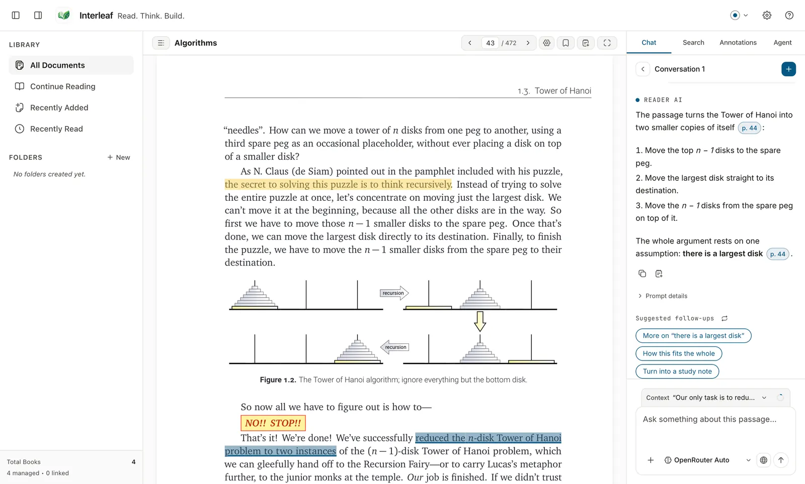

[Wiki home](README.md) › AI Chat

# AI Chat

AI Chat is the reading half of Interleaf's AI. You ask a question about the
document that is open, and the answer is built from document context — with chips
you can click to jump back to the page the answer came from.

Chat is not an agent: it does not edit your files, and Interleaf gives it no
working directory and no way to act on your project. That is
[AI Agent](ai-agent.md). Be aware of two qualifications, though, and neither is
a footnote:

- **It is not literally tool-free for every provider.** Interleaf asks each
  chat provider to answer without reaching for tools, and for most of them it
  runs the tool in a genuinely tool-free mode. The ChatGPT/Codex path is
  different: it runs the CLI over a deliberately narrowed, read-only path rather
  than with no tool surface at all. See
  [ChatGPT (subscription)](providers/chatgpt-subscription.md#an-honest-note-on-how-chat-runs).
- **Sending with an empty context bar still sends document text.** See
  [What gets sent when you attach nothing](#what-gets-sent-when-you-attach-nothing).

---

## On this page

- [Opening the panel](#opening-the-panel)
- [Starting a conversation](#starting-a-conversation)
- [Attaching context](#attaching-context)
- [What gets sent when you attach nothing](#what-gets-sent-when-you-attach-nothing)
- [Asking a question](#asking-a-question)
- [Reading the answer](#reading-the-answer)
- [Suggested follow-ups](#suggested-follow-ups)
- [Prompt details](#prompt-details)
- [Citations](#citations)
- [Context notices](#context-notices)
- [Choosing a provider and model](#choosing-a-provider-and-model)
- [Web search](#web-search)
- [The context window meter](#the-context-window-meter)
- [Clean Context](#clean-context)
- [Conversation history](#conversation-history)
- [When something goes wrong](#when-something-goes-wrong)

---

## Opening the panel

1. Open a document.
2. Show the right companion panel if it is hidden — `⌘ Shift + A` on macOS,
   `Ctrl + Shift + A` on Windows and Linux.
3. Select the **AI Chat** tab.

With no document open the panel says *Open a document to start a grounded
research conversation.* Chat is always about one document.

---

## Starting a conversation

The panel opens on **Conversations** — the history screen for this document.

1. Select **New conversation** (the **+** control in the **Conversations**
   header).
2. Interleaf creates a session bound to the provider and model selected in the
   composer, and takes you straight to the thread.

An empty thread reads:

> **Start with this document**
> Grounded answers cite exact pages and sections. Attach pages or a selection
> with Add context to focus an answer.

Under it are **starter prompts** such as **Summarize this document**,
**Explain the key ideas** and **Outline the argument** (and, when something is
attached, one that explains the attached context). A starter only fills the
composer and puts the cursor there; nothing is sent until you send it.

To get back to the list, select **Back to conversations** in the thread header.
**New chat** (also in the thread header) starts another one.

---

## Attaching context

The context bar sits at the top of the composer card: an **@ Add context**
button, then a count such as **Context · 3 items**, then the attached
chips. The **Entire document** chip works before the first message, too:
attaching starts the conversation. Pinning is how you control precisely what a turn is answered
from: when the bar has anything in it, the model sees exactly that and nothing
else is added. (When the bar is *empty*, Interleaf attaches a bounded window
around where you are reading — see
[What gets sent when you attach nothing](#what-gets-sent-when-you-attach-nothing).)

### From a selection

1. Select text in the reader.
2. In the **Selection actions** toolbar, choose **Ask AI**.

The passage is pinned as a chip, the chat panel opens, and the cursor lands in
the composer. This is the most precise way to ask about something.

### A page range (PDF only)

1. Select **@ Add context** in the context bar. (Screen readers and its tooltip
   call it **Add pages to AI context** in a PDF, **Add context** in every other
   format.)
2. In the **Add context** popover, fill in **Start page** and **End page**.
3. Select **Add range**.

The popover tells you the limits up front: *Add up to 250 consecutive PDF pages.
This document has N pages.* Out-of-range entries are refused in plain words —
for example *Choose no more than 250 pages at a time.* or *End page must be
greater than or equal to start page.*

In EPUB, MOBI, DOCX, PPTX and Markdown the same popover has no page fields, only the
reminder: *Select text in the document or use a note's chat action to attach it
here.* Those formats have no stable page numbers to range over — see
[Formats](formats/README.md).

### The whole document

Select **Entire document** at the end of the context bar. It is a toggle, not a
chip: select it again to remove it. Its tooltip says which state you are in
(*Add the entire document to AI context.* / *The entire document is in AI
context. Select to remove it.*).

A whole book is usually more than a model's context window holds. Interleaf
handles that honestly rather than silently — see
[Context notices](#context-notices).

### From a note

A note's chat action attaches that note's passage the same way. See
[Highlights and notes](highlights-and-notes.md).

### Removing context

Each chip carries its own remove control, named **Remove &lt;label&gt; from AI
context**.

---

## What gets sent when you attach nothing

This is the one piece of Chat behaviour that is easy to get wrong, so it is
worth stating flatly.

**If you send a question while the context bar is empty, Interleaf attaches a
bounded slice of the document around your current reading position and sends
that with your question.** An empty context bar does not mean "no document text
is sent".

What it attaches depends on the format:

| Format | What is attached automatically |
| --- | --- |
| PDF | The pages from ten before to ten after your current page — up to 21 pages — clamped to the start and end of the document. |
| EPUB, MOBI, DOCX, PPTX, Markdown, web articles | The indexed chunk at your current reading location. |

Three things follow:

- **It is bounded, and it is never the whole document.** A whole book is only
  ever sent if you pin **Entire document** yourself.
- **It is visible afterwards.** The attachment appears as a chip in the context
  bar, exactly like one you added, so you can see what the turn was answered
  from — and remove it before the next question.
- **It only happens when the bar is empty.** A conversation you have already
  built context for is left exactly as you built it; nothing is quietly added
  alongside your pins.

If you want a question answered from a specific passage rather than from
wherever you happen to be scrolled, pin that passage first. If you want no
document text sent at all, Chat is not the right tool — it is designed to be
grounded in the document you are reading.

> **AI Agent works the opposite way.** There, nothing from your document is sent
> unless you attach it explicitly, and the footer says so. Do not carry an
> assumption from one panel to the other. See
> [AI Agent ▸ Attach document context](ai-agent.md#2-attach-document-context).

---

## Asking a question

1. Type in the composer.
2. Press <kbd>Enter</kbd> to send. <kbd>Shift</kbd>+<kbd>Enter</kbd> inserts a
   newline.

Or select **Send**. While an answer is generating the same button becomes
**Stop**, and the thread shows *Generating response…*

Press <kbd>↑</kbd> and <kbd>↓</kbd> in the composer to walk back through
questions you already asked, the way a terminal does.

The composer's placeholder tells you whether it can be used at all:

| Placeholder | What it means |
| --- | --- |
| *Ask about this document…* | Ready. After the first answer it reads *Ask a follow up…*, and after **Ask AI** on a selection, *Ask something about this passage…* |
| *Checking available AI providers…* | Provider discovery is still running. |
| *Could not check AI providers. Use Check Again above, or open Settings.* | Discovery failed. |
| *No AI provider is ready. Open Settings to connect OpenRouter or Claude.* | Nothing is configured. See [AI providers](ai-providers.md). |
| *Create a session to begin…* | No conversation is open yet. |
| *This conversation is archived. Create a new session to ask questions.* | Archived threads are read-only. |

---

## Reading the answer

Each answer carries two actions once it has finished:

- **Copy answer** — copies the text. Confirms with *Answer copied*.
- **Save answer as note** — stores it as a note on the document, so it lands in
  the [annotations browser](highlights-and-notes.md#the-annotations-browser)
  with everything else. Confirms with *Note saved*.

If a turn ended early you will see **Stopped** (you pressed **Stop**) or
**Generation failed** (the provider did not complete it).

*A cited answer about an attached passage. The answer is a fixed sample from a
test fixture; no model was called to produce it.*

---

## Suggested follow-ups

Under the latest finished answer, **Suggested follow-ups** offers a few chips:
one that goes deeper (for example **More on “…”** for a term from the answer),
one that zooms out (**How this fits the whole**), and one that does something
with the answer (such as **Turn into a study note** or **Quiz me on this**).
**Refresh suggestions** (the circular arrow) swaps in different ones.

If an answer failed or was stopped, the only chip is **Retry**, which puts the
same question back in the composer.

Like starter prompts, a follow-up **only fills the composer**. Nothing is sent
until you send it, so you can edit it first. No chips appear while an answer is
still streaming.

---

## Prompt details

Each answer has a collapsed **Prompt details** section. Open it to see:

- **Prompt** — the exact question that produced the answer.
- **Answer parameters** — the facts Interleaf recorded, such as the provider
  and model.
- **Copy prompt** and **Reuse prompt**. Reuse puts the question back in the
  composer; it does not send it.

Provider and model are the conversation's binding. Prompt details does not show
which context a past turn used, because that is not recorded.

---

## Citations

Answers cite their sources inline as small chips. A chip reads **p. 14** when
the source has a page number, otherwise the section heading, and hovering it
shows *Jump to &lt;source&gt;*. Select a chip and the reader scrolls to that
passage.

Under the hood the model writes markers of the form `[src-1]`. Interleaf turns a
marker into a chip **only** when it matches a source that was actually attached
to that turn. A marker the model invented stays as plain text — you can tell at a
glance whether a citation is real, because an unreal one is not clickable.

Links a model writes are treated with the same suspicion: an unsupported or
unsafe link is rendered inert with the tooltip *Unsafe or unsupported links are
disabled*.

---

## Context notices

When a turn could not carry everything you attached, a yellow notice appears
under the answer beginning **Context partially included:**. It always names the
item and the numbers, for example:

> **Context partially included:** "Chapter 3" (8 of 31 chunks included; 23
> omitted due to model context window limit).

Or, for a pinned whole document too large for the model:

> **Context partially included:** "Thinking, Fast and Slow" is too large for this
> model, so only context near your current position was included: pages 120–133
> (11 of 402 chunks included; 391 omitted).

This is a statement about the answer you just read, not a warning about the
future: judge the answer accordingly, then attach a narrower range and ask again.

---

## Choosing a provider and model

The composer's control row has two menus: **AI provider** and **AI model**.

- Only providers that are ready to answer chat right now appear in the provider
  menu: installed or reachable, and signed in. Agent-only providers such as
  Antigravity and OpenCode never appear — see the
  [capability matrix](ai-providers.md#the-capability-matrix). The menu always
  ends with **Edit**, which opens Settings, even when no provider is ready.
- If a conversation's provider stops being ready, the conversation stays bound
  to it: the menu still names it, sending is blocked with an explanation, and it
  is not switched to another provider for you. It is simply not offered as a
  choice until it is ready again.
- The model menu shows **Provider default** when no specific model is bound.
- A conversation is bound to its provider and model when it is created. The
  card in **Conversations** shows the bound model as a chip.

---

## Web search

The **Web search** control is a single glyph in the composer's control row, and
it appears **only when the bound provider declares hosted web search**. In
practice that means [OpenRouter](providers/openrouter.md) and nothing else.

It is a per-turn opt-in: turn it on, ask the question, and it is off again for
the next one. Nothing is searched unless you asked for it on that turn — a
hosted search costs money, so it is never inherited.

When a turn used search, the answer is followed by a **Web sources** list of the
pages it drew on, each labelled with its validated host.

**These references are not clickable links.** Interleaf displays each one as
inert text, not as something you can select to open — nothing navigates, in the
app or in your browser. If you want to visit a source, read the address and open
it yourself. That is deliberate: a URL that arrived in model output is untrusted
content, and a one-click link out of a reading pane is exactly the thing worth
not offering.

---

## The context window meter

The small ring beside **Send** shows how full the model's context window was on
the last request. Hovering it gives the figures:

> Context window: last request used 18,402 of 128,000 tokens (estimated)

Select it to open the **Context window** panel, which breaks the same estimate
down:

| Group | Rows |
| --- | --- |
| System | System instructions |
| Conversation | Current prompt, Chat history |
| Document context | Sources and provenance, Serialization overhead |
| Reserved | Safety headroom, Reserved for response |

Two honest gaps are worth knowing about:

- The accounting describes the **last packed request**. A conversation that was
  just restored, or rebound to another model, has none yet, and the panel says
  so: *Context usage statistics are unavailable for this conversation. They
  appear again after the next message is sent.* No zero is shown in place of a
  measurement.
- Over a plain OpenAI-compatible local server the true window size is not
  discoverable, so a conservative default is assumed. See
  [Local server](providers/local-server.md).

Select **Close** to dismiss the panel, or press <kbd>Esc</kbd>.

---

## Clean Context

A long conversation eventually crowds out the document. **Clean Context**, in
the context-window panel, compacts it: the provider writes a summary of the
conversation so far, and later turns use that summary in place of the earlier
turns.

1. Select the context ring beside **Send**.
2. Select **Clean Context**.
3. Read the confirmation, then select **Clean Context** again — or **Cancel**.

The confirmation is explicit about both consequences:

> This asks &lt;provider&gt; to summarise the conversation so far, then uses
> that summary in place of the earlier turns. Your messages stay visible, and
> the attached context is removed.

So: your visible transcript is not deleted, but **your pinned context chips go
away** and you will need to re-attach what still matters. It also spends a real
provider call, which is why it asks first. While it runs the panel shows
*Cleaning this conversation…* and context cannot be added or removed.

---

## Conversation history

The **Conversations** screen lists every thread for the open document. Each card
shows the title, a preview of the last message, the bound model as a chip, and a
metadata line such as:

> 12 MSG · 2H AGO · ARCHIVED · PROVIDER UNAVAILABLE

| Segment | Meaning |
| --- | --- |
| `12 MSG` | Message count. |
| `JUST NOW` / `14M AGO` / `3H AGO` / `YESTERDAY` / `4D AGO` / `2026-08-02` | When it was last updated. |
| `ARCHIVED` | Read-only. Start a new conversation to keep going. |
| `PROVIDER UNAVAILABLE` | The provider this thread is bound to is not currently ready. |

Actions on a card:

- Select anywhere on the card to **open** it.
- The overflow menu (**Actions for &lt;title&gt;**) offers **Rename** and
  **Delete**.
- **Delete** asks first: *Delete this conversation?* Conversations are stored
  locally and deleting one cannot be undone.

The header also has **Configure AI providers**, which jumps straight to
[Settings ▸ AI Providers](ai-providers.md).

---

## When something goes wrong

| What you see | What to do |
| --- | --- |
| **No AI Provider Ready** — *Reader Chat requires a configured provider…* | Select **Configure Providers** and set one up. See [AI providers](ai-providers.md). |
| *Could not check AI providers* | Select **Check Again**, or **Open Settings**. |
| A provider is missing from the menu | It is not ready (not installed, not reachable or not signed in), or it is agent-only. Check its row in Settings and the [capability matrix](ai-providers.md#the-capability-matrix). |
| **Generation failed** | Re-send. If it repeats, check the provider's status row in Settings. |
| Answers ignore part of what you attached | Read the **Context partially included** notice; attach a narrower range. |
| The **Web search** glyph is absent | Only OpenRouter offers it. |
| Answers are vague | Attach a selection or page range rather than the whole document. |

More in [Help and troubleshooting](help-and-troubleshooting.md#ai-providers).

---

Related: [AI providers](ai-providers.md) · [AI Agent](ai-agent.md) ·
[Highlights and notes](highlights-and-notes.md) ·
[Keyboard shortcuts](keyboard-shortcuts.md)
