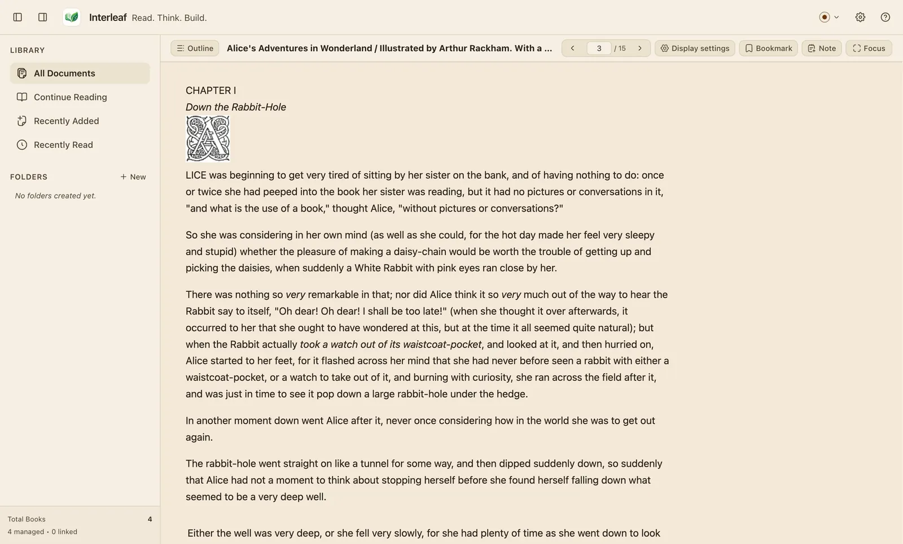

[Wiki home](../README.md) › [Document formats](README.md) › EPUB

# EPUB

**Extensions:** `.epub` · **Layout:** reflowable · **Reader:** a hardened
Foliate-derived engine

---

## What works well

- **The text reflows to your settings.** Font size, font family, line spacing,
  margins and content width all take effect, and the book re-wraps around them.
- **Table of contents** from the book's own navigation (EPUB 3 nav documents and
  EPUB 2 NCX), with a section-based fallback when a book supplies neither.
- **Precise position memory.** Interleaf records where you are as you scroll and
  restores that exact spot when you reopen the book.
- **Durable highlights.** Annotations are anchored with the book's own canonical
  location (an EPUB CFI) *and* the quoted text and its context, so they survive a
  layout change.
- **Book images render** from inside the book.
- **Full-text search** across the whole book.

*A public-domain EPUB in the Sepia palette.*

---

## Limitations

### DRM-protected books cannot be opened

Commercially protected EPUBs are refused with:

> This document appears to be DRM-protected and cannot be opened by Interleaf.

Interleaf checks the book's encryption declaration and fails closed on anything
it cannot positively identify as ordinary font obfuscation. Removing DRM is out
of scope and will not be added.

If you own the book, obtain a DRM-free copy from the publisher.

### The publisher's styling is not preserved verbatim

To keep the reader safe and consistent, Interleaf strips the book's own CSS and
applies its own typography. Books with elaborate custom layouts will look plainer
than in some other readers — but they will be readable and consistent with the
rest of your library.

Also removed, in every book:

- **Scripts**, and anything that could run.
- **Frames, objects and embeds.**
- **Form controls.**
- **Remote images, fonts and stylesheets** — a book never causes a network
  request while you read it.
- **SVG.** Ordinary raster images inside the book render normally.
- **Audio and video.** Their captions and surrounding text remain.

### Page numbers are derived

An EPUB has no fixed pages. The page numbers Interleaf shows come from how the
book lays out at *your* current settings, so they change if you change your font
size. Your position and your annotations do not move — only the numbering.

That is also why AI Chat offers a page range for PDF only. For an EPUB, attach a
selection, your current location, or the whole document instead.

---

## Tips

- If a book renders oddly, try the **Display settings** popover — *Relaxed lines*
  plus *Wide margins* rescues a surprising number of badly built EPUBs.
- Very large EPUBs are unpacked under strict bounds and a time limit. A book that
  refuses to open may be corrupt or built abusively; try another copy.

---

Next: [MOBI, AZW and AZW3](mobi-kindle.md) · [Back to formats](README.md) ·
[Highlights and notes](../highlights-and-notes.md)
