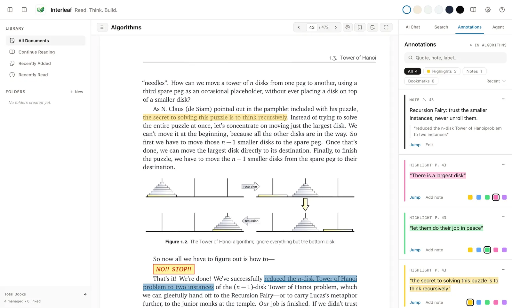

[Wiki home](README.md) › Highlights and notes

# Highlights and notes

Interleaf saves three kinds of annotation: **highlights**, **notes** and
**bookmarks**. All of them live in Interleaf's own database — your document file
is never modified.

**On this page**

- [Importing highlights](#importing-highlights)
- [Highlighting a passage](#highlighting-a-passage)
- [Learning in the margin](#learning-in-the-margin)
- [Notes](#notes)
- [Bookmarks](#bookmarks)
- [The Annotations browser](#the-annotations-browser)
- [Editing and deleting](#editing-and-deleting)
- [When a highlight loses its place](#when-a-highlight-loses-its-place)
- [Size limits on a single selection](#size-limits-on-a-single-selection)

---

## Importing highlights

In the library, choose **Imported highlights**, then **Choose export…**. Select
Kindle `My Clippings.txt` or a Readwise **Highlights bulk export CSV** with
`Highlight` and `Book Title` columns (the `Title` alias is also accepted).
Optional `Book Author` (or `Author`), `Note`, `Location`, and
`Highlighted at` columns are retained. Readwise Reader library metadata CSV is
not a highlights export and is not supported. Files must be UTF-8 or
BOM-marked UTF-16 and at most 5 MB. CSV fields may contain quoted newlines; the import accepts at most 10,000 rows,
64 columns per row and 32,000 characters per field. Kindle highlights must use
English metadata containing “Highlight”; unrecognized types are reported. Individual highlights are limited to
20,000 characters, titles to 250 and authors to 150; over-limit entries are
reported and skipped.

Review counts, duplicate warnings, source titles and sample text, then choose
**Confirm import**. You can search your library and explicitly associate a
source title with a document, or leave it unmatched and associate it later.
The associated book can be opened from a saved highlight. The provider's page
or location is retained as source metadata: it does not verify a passage or
navigate to one. Re-importing the same records skips duplicates. Kindle notes,
bookmarks and unrecognized clipping types are reported as unsupported; malformed
or incomplete rows are reported and skipped. No export file is changed.

---

## Highlighting a passage

1. Select text in the reader. The **Selection actions** toolbar appears next to
   your selection.
2. Under the word **Highlight**, click one of the five colour swatches.
3. The highlight is saved immediately and painted on the page. The toolbar
   closes and you keep reading: the companion panel stays as it was — closed,
   or open on whichever tab you had — and on a narrow window the companion
   drawer does not open. To see your highlights, open the **Annotations** tab
   yourself (see [The Annotations browser](#the-annotations-browser)).

The five colours are **Yellow**, **Blue**, **Green**, **Pink** and **Purple**.
Yellow is the default. Colour is never the only cue: hovering or
keyboard-focusing a swatch shows its name in plain text beside the row, and each
button's accessible name is, for example, *Yellow highlight*.

The same toolbar also offers:

| Button | What it does |
| --- | --- |
| **Learning** | Start a learning item from the selected passage (see below). |
| **Add note** | Attaches a note to the selected passage (see below). |
| **Copy** | Copies the selected text to the clipboard. |
| **Ask AI** | Sends the selection to the AI Chat panel as context. See [AI Chat](ai-chat.md). |
| **Submit to agent** | Attaches the selection to an agent task. See [AI Agent](ai-agent.md). |
| × | Closes the toolbar. `Esc` does the same. |

---

## Learning in the margin

Select a passage and choose **Learning** in the selection toolbar. Give the
item a title and text, choose **Chapter primer**, **Passage question**,
**Section checkpoint**, or **Conflict prompt**, and choose **Save**. A conflict
prompt needs a second passage: leave the draft open, select the other passage
(in this document or another library document), and choose **Learning** again.
The source quotes appear in the margin; the text you enter is displayed as text,
not interpreted as instructions. Authoring and saving do not send document
content to an AI provider. Each source anchor is limited to 32,000 serialized
characters, and a document can hold up to 250 active or dismissed learning
items; remove an item to make room.

The margin shows items near the current passage. **Show all learning** lists the
current document's items; **Show nearby** returns to the reading region. Use
**Open source** or **Open other source** to return to a passage. If a document
is missing or changed, or a passage cannot be resolved, Interleaf reports that
instead of guessing a destination. **Dismiss** keeps an item marked dismissed;
**Remove** removes it from the margin. Highlights and notes remain separate.
Like annotations, items for a file opened without importing are temporary and
are discarded when that file is closed. Import a document into the library to
keep its learning items.

## Notes

There are two kinds, and they behave differently. Both use the same note card,
in your reading font. A note on selected text opens inside the selection
toolbar itself, below its buttons, and the toolbar's **×** closes it.

Notes save themselves as you type: a moment after you pause, the card's status
changes from *Unsaved changes* to *Saved*. There is no Save or Cancel button.

- **Done**, or `⌘ Enter` / `Ctrl + Enter`, saves the latest text and closes
  the card.
- `Esc`, the **×** in the corner, or clicking elsewhere also save the latest
  text before they close it.
- Plain `Enter` starts a new line.
- A card you close without typing anything creates no note.
- If a save fails, the card stays open with your text and says why. Choose
  **Retry**, or **Discard** to give up the unsaved text. When the save cannot
  succeed by trying again, only **Discard** is offered.
- If the card goes away for another reason, such as when you open another
  document, the selection changes, or you edit a different row in the
  Annotations panel, your latest text is still saved to the note it was opened
  on. If that save fails, the note is kept. It reappears under **Note** the next
  time that document is open, with the text, the place it was anchored, the
  reason, and **Discard**, plus **Retry** when the save can be tried again.
  Only **Discard** gives the text up. It does not move your cursor. If the note already
  exists, editing it again from the Annotations panel continues the same
  unsaved text.
- Quitting Interleaf saves any note you are still typing first. Kept notes
  exist only while Interleaf is running, so if a save keeps failing at quit,
  or the app stops unexpectedly, the unsaved text is lost.

### A note on selected text

1. Select the passage.
2. Click **Add note** in the selection toolbar.
3. The toolbar expands to hold the note. Type below the passage you selected,
   which is quoted above your text.
4. Click **Done** when you have finished.

The note is anchored to that passage, so it travels with the text. Unlike a
highlight, a note finished with **Done** opens the Annotations panel and
scrolls the new note into view (except in Focus Mode, which stays
distraction-free). Saving as you type, and closing the card any other way,
leave the panels as they were.

### A note at your current location

Use this when there is nothing in particular to select — a thought about the
page as a whole.

1. Click **Note** in the reader toolbar.
2. Type in the note card. Its top line shows where you are: the page and how
   far through the document.
3. Click **Done**.

In the Annotations browser, the two are labelled *Text note* and *Location note*.

---

## Bookmarks

Press `⌘ B` / `Ctrl + B`, or click **Bookmark** in the reader toolbar, to save
your place. The bookmark is labelled with the page it was made on, the
Annotations panel opens, and the new bookmark is scrolled into view so you can
rename it straight away.

---

## The Annotations browser

Open the companion panel's **Annotations** tab, or press `⌘ Shift + N` /
`Ctrl + Shift + N`.

The panel is headed **Annotations**, with a count of how many exist in the
current document.

- **Search box** (*Quote, note, label…*) — searches the highlighted text, your
  note text and bookmark labels.
- **Filter chips** — **All**, **Highlights**, **Notes**, **Bookmarks**, each
  showing its count.
- **Sort** — **Recent**, **Newest**, **Oldest**.
- Long lists are paginated.

*Highlights on the page and in the Annotations browser. The highlights and the note are demo annotations.*

Each entry offers:

| Action | Effect |
| --- | --- |
| **Jump** | Opens the document at that annotation. |
| **Edit** | Edits the note text or bookmark label. On a highlight with no note yet, the button reads **Add note**. |
| Colour swatches | On a highlight, click a swatch to recolour it in place. |
| **⋯ ▸ Delete** | Deletes the annotation, after a confirmation. |

Delete lives in the overflow menu rather than on the row, so a mis-aimed click
on a crowded row cannot destroy an annotation.

---

## Editing and deleting

Editing is inline. Choose **Edit** and change the text. A note's text, or a
highlight's note, opens in the same note card and saves as you type. Choose
**Done** when you have finished. Emptying a highlight's note removes the
note but keeps the highlight. A note needs some text, so to remove a note,
delete it instead. A bookmark's label still has **Save** and **Cancel**.

Deleting asks *Delete this annotation? This cannot be undone.* There is no undo
afterwards, so the confirmation is the only safety net.

---

## When a highlight loses its place

Reflowable documents can lay out differently after a font, width or version
change, and a highlight's original anchor may no longer match. Interleaf stores
several anchors per annotation — the format's own location plus the quoted text
and its surrounding context — and recovers the position automatically where it
can.

When it cannot, the entry offers **Re-attach** instead of **Jump**. Choosing it
opens the recorded location and shows:

> Opened the recorded location. If the moved text is on that page, its place is
> restored automatically.

So the workflow is: click **Re-attach**, look at the page, and if the passage is
there the anchor repairs itself.

---

## Size limits on a single selection

Highlights and notes are anchored to a specific passage, which means very large
selections cannot be stored as one annotation. If you select too much, the
toolbar explains the limit and points you at the right tool instead:

- *Highlights and notes are limited to 50 pages. Use Ask AI for large ranges.*
- *Highlights and notes are limited to 100 blocks. Use Ask AI for large ranges.*
- *Highlights and notes are limited to 100 paragraphs. Use Ask AI for large
  ranges.*
- *Highlights and notes are limited to 256,000 characters. Use Ask AI for large
  passages.*
- *Highlights and notes could not be mapped to document segments
  deterministically. Use Ask AI for this selection.*

In all of those cases **Ask AI** still works: chat context is not limited the
same way, and can take a page range or the whole document. See
[AI Chat](ai-chat.md#attaching-context).

---

Next: [AI Chat](ai-chat.md) · [Reading a document](reading.md) ·
[App navigation](navigation.md)

## Practice cards

In the Annotations browser, choose **Make practice card** on an anchored highlight, enter a question and save. In the library, choose **Review practice** to review up to 20 due cards across your library. Write an answer, reveal the saved source and compare it before choosing Again, Hard, Good or Easy. Your rating determines the next due date.

You can explicitly choose an eligible tool-free provider and send the question, answer and displayed evidence for an optional comparison. This may use provider credits and the feedback may be wrong. Manual comparison remains available when no provider is ready. A missing or changed source is identified and cannot be opened at an old location. From a saved imported highlight, choose **Make practice card** and enter a question. During review, **View exported highlight** opens the retained quote and provider details. Imported highlight evidence is an export quote, not a verified book passage; a title association or provider location does not establish an exact passage.
