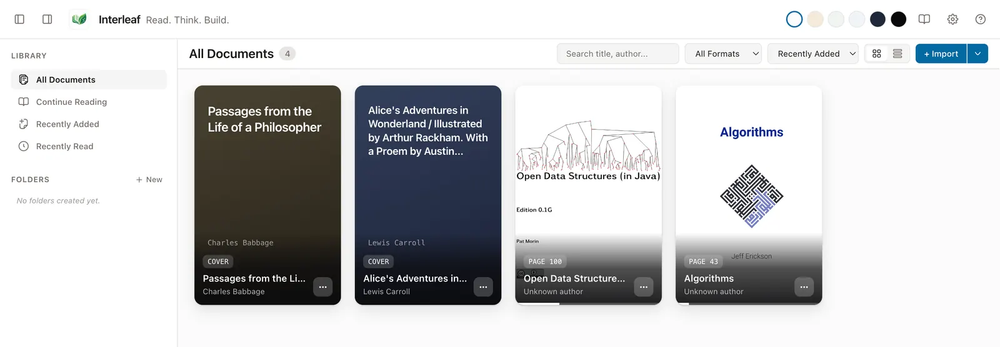

[Wiki home](README.md) › Quick start

# Quick start

Ten minutes from a running app to your first highlight and your first AI answer.
Steps 1–4 need no account and no internet connection. Step 5 is optional.

**On this page**

- [Before you begin](#before-you-begin)
- [1. Launch Interleaf](#1-launch-interleaf)
- [2. Walk through guided setup](#2-walk-through-guided-setup)
- [3. Add your first document](#3-add-your-first-document)
- [4. Read, highlight and take a note](#4-read-highlight-and-take-a-note)
- [5. Ask the AI about the page](#5-ask-the-ai-about-the-page)
- [Where to go next](#where-to-go-next)

---

## Before you begin

You need Interleaf running on your machine. Nothing is published for download
yet (the public release repository has no release so far): either install a build
you already have from someone you trust, or run it from source. Follow
[Installation](installation.md) first, then come back here.

---

## 1. Launch Interleaf

**If you installed Interleaf** from a build you were given, open it from your
Applications folder, Start menu or application launcher like any other app.

**If you are running from source**, open a terminal in the project folder and
run:

```bash
npm run dev
```

Either way, the Interleaf window opens on the **Library** view. It is empty on a
fresh install.

---

## 2. Walk through guided setup

The first time Interleaf starts, a guided setup dialog appears. It has four
steps, shown as **Step 1 of 4** through **Step 4 of 4**.

1. **Welcome to Interleaf** — explains that reading, highlighting and notes
   happen on this machine and need no account and no AI. Choose **Continue**.
2. **Find your AI tools** — Interleaf checks which supported AI command-line
   tools are already installed, and asks a configured local server for its model
   list. It does not run any model here, and no request is billed. Each row shows
   a status such as *Ready for Reader Chat*, *Sign-in required*, *Not installed*
   or *No local server responding*, with an action button such as **Installation
   help**, **Sign in with ChatGPT** or **Check connection**. Use **Check again**
   after you install something. Choose **Continue**.
3. **Choose your defaults** — connect whatever you want to use, then
   answer *Use one of these for Reader Chat by default?* and *Use one of these
   for Agent Mode by default?* Each has a **Provider** menu, an optional
   **Model** menu (whose first option is *Let the provider choose*), and the
   buttons **Use this default** and **Not now**. Defaults apply to *new*
   conversations and *new* agent drafts only. Choosing a default grants nothing
   and starts nothing.
4. **Add your first document** — use **Choose file…** to import a file, or
   **Save a web article** to capture a page from the web.

Then choose **Start reading**.

> **In a hurry?** Every step is optional. Use **Skip AI setup** on the AI steps,
> **Finish later** to close the dialog, or the **Close setup** button (×) in the
> corner. You can reopen the whole flow later from **Settings ▸ General ▸ Guided
> setup ▸ Run guided setup**.

If you upgraded from a version without guided setup, the dialog does not open
by itself. A small **Set up AI providers?** card offers it instead, with
**Start setup** and **Not now**; your settings, library and annotations are left
as they are either way.

After the dialog closes, a small **Try one thing** tip may appear with a single
suggestion — *Select a sentence to highlight it.*, *Select a sentence and add a
note.*, or *Ask AI about this page from the companion panel.* (the last only when
an AI provider is actually ready). Dismiss it with **Got it**.

---

## 3. Add your first document

1. In the Library, click **+ Import**.
   *(Or press `⌘ ⇧ O` on macOS / `Ctrl + Shift + O` on Windows and Linux.)*
2. Pick the file in the **Import Documents to Interleaf** dialog and click
   **Import**. You can select several files at once.
3. The document appears in the library grid.


*The library with four openly licensed demo books.*

Supported file types are **.pdf**, **.epub**, **.mobi**, **.azw**, **.azw3**,
**.docx**, **.pptx**, **.md** and **.markdown**.

Just want to read a file once? **Open** (`⌘ O` / `Ctrl + O`, or the **Open file**
button in the header) reads it without adding it to your library, and discards
its highlights and notes when you close it. See
[Open a file without importing it](adding-documents.md#open-a-file-without-importing-it). To capture an article from the web
instead, use the small caret next to **+ Import** and choose **From web URL…**.

Full details, including where the file is stored and how to link a file in place
rather than copying it: [Adding documents](adding-documents.md).

---

## 4. Read, highlight and take a note

1. Click the document to open the reader.
2. Turn pages with `→` / `Page Down` and `←` / `Page Up`, or type a page number
   into the page field in the toolbar.
3. Press `T` to open the **Table of Contents**, or use the **Outline** button.
4. **Select some text.** A small toolbar appears over the selection.
5. Under **Highlight**, click one of the five colour swatches. Hover or
   keyboard-focus a swatch and its name appears beside it — *Yellow*, *Blue*,
   *Green*, *Pink*, *Purple*.
6. Click **Add note** to attach a note to that passage. Type it in the note
   card. It saves as you type. Choose **Done** (or press `⌘ Enter` /
   `Ctrl + Enter`) when you have finished.
7. The same toolbar also offers **Copy**, **Ask AI** and **Submit to agent**.
8. Press `⌘ Shift + N` / `Ctrl + Shift + N` to open **Annotations** in the right
   panel and see everything you have saved.

Try `F11` for **Focus Reading Mode** and `Esc` to leave it. Switch reading
palettes with the **Reading palette** button in the header.

More: [Reading a document](reading.md) and
[Highlights and notes](highlights-and-notes.md).

---

## 5. Ask the AI about the page

This step only works once a provider is connected. If you skipped that, see
[AI providers](ai-providers.md) — [OpenRouter](providers/openrouter.md) (paste an
API key) and [Local server](providers/local-server.md) (point at a server you
already run) are the two quickest routes.

1. Press `⌘ Shift + A` / `Ctrl + Shift + A` to open the companion panel, then
   select the **Chat** tab.
2. Choose **New conversation**.
3. Attach what the AI should look at. Select text in the document, or use the
   **+** button on the **CONTEXT** bar to add a page range or the whole
   document. The bar shows how many items are attached.

   If you send a question with the **CONTEXT** bar empty, Interleaf attaches a
   bounded window around your current reading position for you — about ten PDF
   pages either side of the page you are on, or the current chunk in a
   reflowable format — and it appears in the bar as a chip. It is never the
   whole document. See
   [What gets sent when you attach nothing](ai-chat.md#what-gets-sent-when-you-attach-nothing).
4. Type your question in the composer and press `Enter` (`Shift + Enter` inserts
   a newline).
5. The answer streams in. Numbered citation chips such as `[src-1]` appear where
   the model referred to your attached context — click one to jump to that place
   in the document.
6. Useful follow-ups: **Copy answer**, **Save answer as note**, or **Stop** to
   end a long generation.

More: [AI Chat](ai-chat.md).

---

## Where to go next

- Hand a coding task to an agent CLI on your machine — [AI Agent](ai-agent.md)
- Learn every panel and control — [App navigation](navigation.md)
- See what each file format supports — [Document formats](formats/README.md)
- Memorise the shortcuts — [Keyboard shortcuts](keyboard-shortcuts.md)
- Something not working? — [Help and troubleshooting](help-and-troubleshooting.md)
