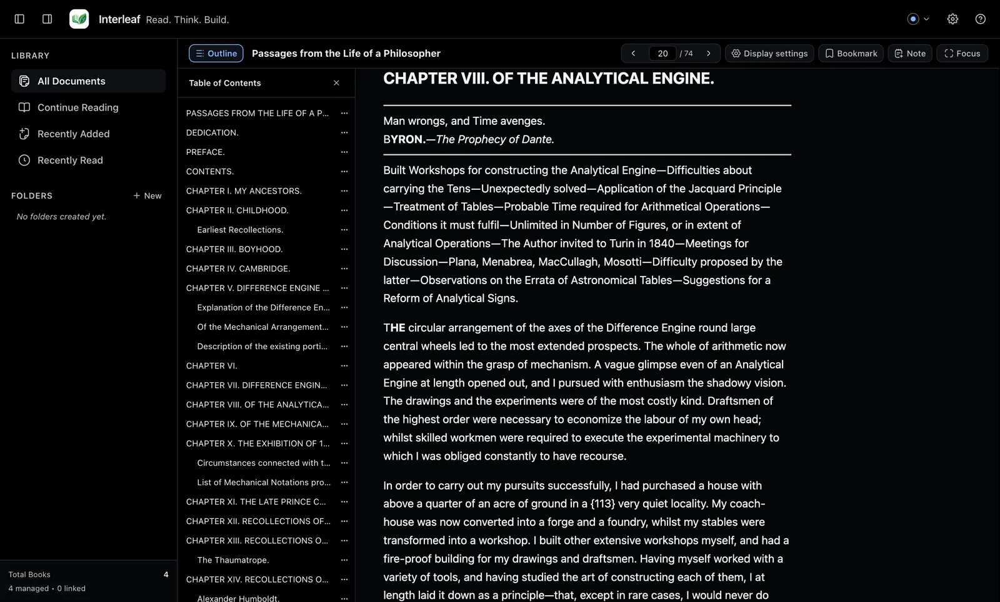
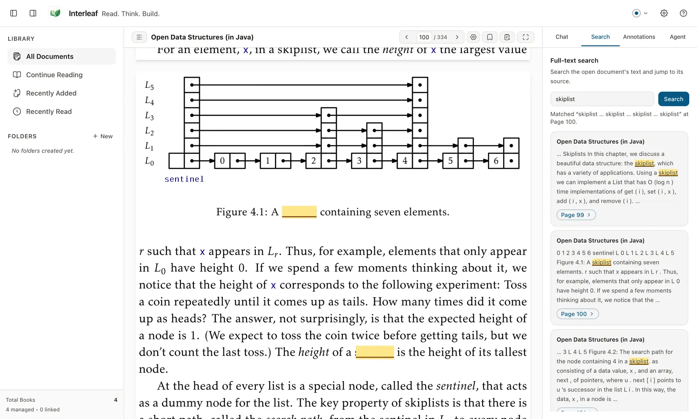

[Wiki home](README.md) › Reading a document

# Reading a document

**On this page**

- [Opening a document](#opening-a-document)
- [Moving around](#moving-around)
- [Table of contents](#table-of-contents)
- [Display settings](#display-settings)
- [Reading palettes](#reading-palettes)
- [Reader preferences in Settings](#reader-preferences-in-settings)
- [Focus Reading Mode](#focus-reading-mode)
- [Searching inside documents](#searching-inside-documents)
- [Where you left off](#where-you-left-off)
- [What readers do not do](#what-readers-do-not-do)

---

## Opening a document

Click any document in the library. Interleaf remembers your reading position, so
reopening a book returns you to where you stopped. To read a file without adding
it to your library, use **Open** (`⌘ O` / `Ctrl + O`) instead — see
[Open a file without importing it](adding-documents.md#open-a-file-without-importing-it).

Reflowable formats (EPUB, MOBI/Kindle, Markdown) adapt to your window and font
settings. PDF is fixed-layout and keeps the publisher's page design. DOCX is
laid out responsively, so its "pages" are derived hints rather than the page
breaks Word would produce. A PPTX deck is shown as reading text, one slide
after another. See [Document formats](formats/README.md).

---

## Moving around

The reader toolbar sits above the page:

1. **Previous page** and **Next page** arrows on either side of the page field.
2. A **Page number** field: type a number, press `Enter`, and you jump there.
   The total page count is shown next to it as `/ N`.
3. Keyboard: `→` or `Page Down` for the next page, `←` or `Page Up` for the
   previous one.

These keys do nothing while you are typing in a text box, which keeps ordinary
editing intact.

---

## Table of contents

Click **Outline** in the toolbar, or press `T`, to open the **Table of
Contents** sidebar. Click an entry to jump to it. Press `T` again to close it.

Not every document supplies a table of contents. A Markdown file or a saved web
article is outlined from its headings; a PDF without embedded bookmarks may have
none at all.

---

## Display settings

Click **Display settings** in the reader toolbar to open the **Document
settings** popover:

| Control | Options |
| --- | --- |
| **Line spacing** | *Tight lines*, *Normal lines*, *Relaxed lines* |
| **Reading margins** | *Narrow margins*, *Normal margins*, *Wide margins* |
| **Zoom preset** | *Fit Width*, *Fit Page*, 50%, 75%, 100%, 125%, 150%, 200%, 300% |
| **Zoom out** / **Zoom in** | Step the zoom down or up |

Line spacing and reading margins apply to **reflowable formats** only; the
popover says so under each control. A fixed-layout PDF ignores them, because its
lines and margins are part of the page image.

Zoom shortcuts: `⌘ +` / `Ctrl + +` and `⌘ −` / `Ctrl + −` to zoom, `⌘ 0` /
`Ctrl + 0` to reset to 100%.

---

## Reading palettes

Interleaf ships six palettes, all designed to meet WCAG 2.1 AA contrast. Switch
between them from the **Reading palette** group in the header, or under
**Settings ▸ Appearance**.

| Palette | Appearance | Character |
| --- | --- | --- |
| **Paper** *(default)* | Light | Warm light neutral — default daytime reading |
| **Sepia** | Light | Traditional low-glare ebook theme |
| **Moss** | Light | Muted, calming natural green |
| **Ocean** | Light | Cool, crisp blue-gray neutral |
| **Graphite** | Dark | Medium slate dark theme |
| **Midnight** | Dark | Deep black OLED reading theme |

*Sepia, a light palette, on a public-domain EPUB.*

*Midnight, the deepest dark palette.*

---

## Reader preferences in Settings

**Settings ▸ Reader** holds the preferences that apply to every document rather
than just the one you have open:

- **Reader background**
- **Font size**
- **Font family** — including an **OpenDyslexic-compatible** option
- **Line spacing**
- **Content width**
- **Paragraph spacing**
- **Page margins**

**Settings ▸ Appearance** additionally has **Chat and Agent text size**, which
sizes the companion panel independently of the page.

---

## Focus Reading Mode

Press `F11`, or click **Focus** in the reader toolbar, to hide everything except
the page. Press `Esc` or `F11` again to return.

`Esc` closes the topmost thing first, so it will not pull you out of Focus Mode
while a dialog, menu or selection toolbar is still open.

*Focus Reading Mode leaves only the page.*

---

## Searching inside documents

Two different searches, easy to mix up:

- The **Search title, author...** box in the library searches *document
  metadata* — titles and authors.
- The companion panel's **Search** tab searches *the text inside documents*.

To search document text:

1. Press `⌘ F` / `Ctrl + F`, or open the companion panel and choose **Search**.
   The panel is headed **Full-text search**: *Search the open document's text
   and jump to its source.*
2. Type into **Search passages…** and press `Enter` or click **Search**.
3. Click a result to jump to that passage.

Search covers the open document only; there is no library-wide full-text
search.

*Full-text search inside the open document.*

If results look incomplete, the document's index may still be building or may
have failed — use **Retry index**. A scanned, image-only PDF has no text layer
at all, so nothing can be indexed from it without OCR, which Interleaf does not
perform.

---

## Where you left off

Interleaf records your reading position per document, and the **Continue
Reading** and **Recently Read** views in the sidebar are built from it. Anchors
for your highlights and notes are format-specific and are recovered when a
reflowable document lays out differently than before — see
[Highlights and notes](highlights-and-notes.md#when-a-highlight-loses-its-place).

---

## What readers do not do

- **No editing.** Interleaf does not modify your PDF, EPUB, Word or PowerPoint file. The
  original stays as it is.
- **No interactive media.** Audio, video, animation, embedded applications,
  frames, forms and document-supplied canvas programs are never played,
  rendered, executed or extracted by any reader. Inert text and captions are
  kept; still images follow each format's own rules.
- **No DRM removal.** A protected book is refused with *This document appears to
  be DRM-protected and cannot be opened by Interleaf.*

---

Next: [Highlights and notes](highlights-and-notes.md) ·
[Document formats](formats/README.md) ·
[Keyboard shortcuts](keyboard-shortcuts.md)
